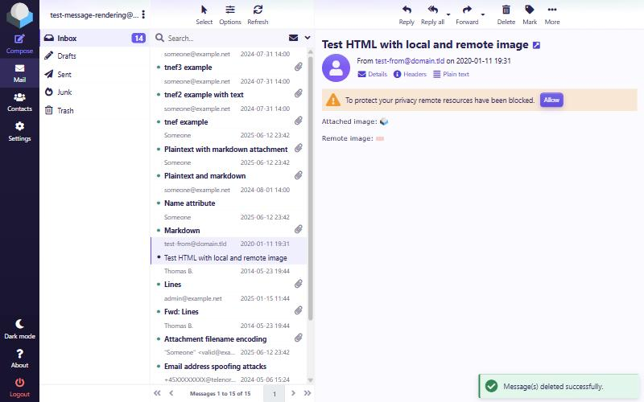
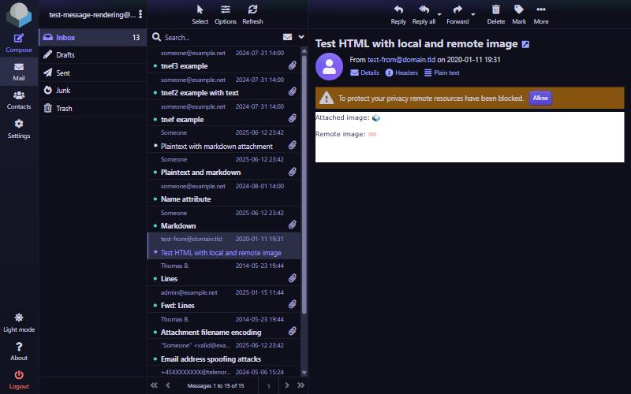
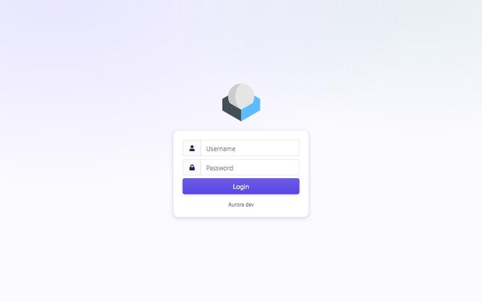
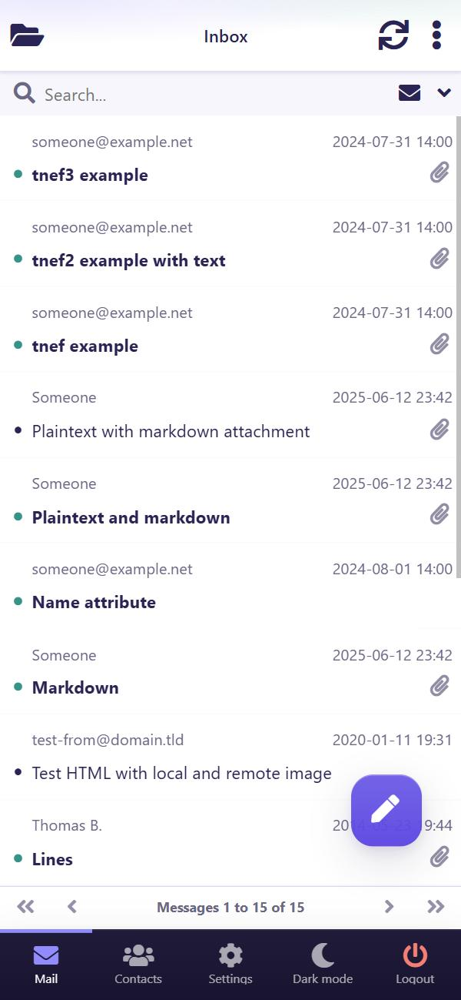

Roundcube Webmail Skin "Aurora"
===============================

Aurora is a modern, mobile-first refresh of Roundcube's **Elastic** skin.

It **extends** Elastic (`meta.json` → `"extends": "elastic"`) rather than forking
it: templates, `ui.js`, Bootstrap and the JavaScript dependencies are inherited
from the parent skin. Aurora ships only what it changes — a design-token layer,
component refinements, a mobile layer, and an accessibility layer.



| Dark theme | Login | Phone |
|---|---|---|
|  |  |  |

Installation
------------

Aurora needs **Roundcube 1.7** and PHP 8.1 or newer. It builds on the Elastic skin
that ships with Roundcube, so keep `skins/elastic` in place.

### With Composer

From the Roundcube root directory:

```sh
composer require mkerstner/aurora
```

This installs the skin into `skins/aurora`. The installer then asks whether to
activate it. **Answering yes makes Aurora the default skin for every user**: it
writes `$config['skin'] = 'aurora'` to `config/config.inc.php`. Answer no to
offer it as a choice instead. `--no-interaction` counts as a yes.

### By hand

Download a [release](https://github.com/mkerstner/roundcube-skin-aurora/releases)
and unpack it so that the skin sits in `skins/aurora`. The archive's top folder
is named after the repository, so rename it: the folder must be called `aurora`.

### After installing

There is nothing to build and no database change. Users choose Aurora under
*Settings → Preferences → User Interface*. If your configuration restricts
`skins_allowed`, add `'aurora'` to the list.

Compatibility
-------------

Aurora 1.0 is built against Elastic from Roundcube 1.7 and tested on 1.7.5.
Elastic's styles and templates are the same across all 1.7.x releases, so the
compiled stylesheet fits each of them.

Templates, `ui.js` and Bootstrap come from your installed Elastic, so fixes to
those arrive with Roundcube itself. Aurora's stylesheet is different: it
**contains** Elastic's compiled CSS, so a CSS change in Elastic only reaches Aurora
through a new build. After a major Roundcube upgrade, look for a matching Aurora
release.

Plugins that bring Elastic templates work under Aurora, which picks up their
pages through its parent skin: `acl`, `enigma`, `help` and `managesieve` were
checked. The `markdown_editor` plugin has its accent colours adjusted, but the
result has not been seen in a running editor.

Developed and tested in Chromium-based browsers, including phone emulation.
Firefox, Safari and real phones have not been tested yet; reports are welcome.

---

Design intent
-------------

The skin is named after a light phenomenon, but its first palette shipped Open
Color indigo 5 (`#4c6ef5`) — probably the most-used "modern app blue" on the
web. It was a perfectly good colour that belonged to nobody.

The current design direction is to earn the name: give Aurora a hue of its own,
bias the neutrals toward it, and spend a small, explicitly bounded budget of
gradient and edge-light on the chrome. The working brief, in one line:

> **A mail client should feel calm and current. Joy belongs in the chrome, not
> in the message list.**

Roundcube is a dense, professional tool that people keep open all day. The
message list is where the work happens, so it stays deliberately plain —
unchanged density, unchanged type scale, no decoration competing with content.
Everything expressive happens at the edges.

Design principles
-----------------

**Neutrals are chosen, not inherited.**
A pure blue-grey reads as unconsidered. Aurora's greys carry a slight violet
bias toward the accent, so nothing reads as *coloured* — it reads as
deliberate. This is the single biggest lever on how current an interface feels,
and it costs nothing in legibility.

**Shadows have a hue.**
Elevation derives from a deep violet (`#1f184a`), not from near-black. Same
offsets, same blurs, same opacities — only the hue changes. It is the
difference between a box with a shadow and a surface that looks lit.

**Decoration runs on a fixed budget.**
Gradients are allowed on exactly four surfaces: the task rail / bottom nav,
primary buttons, avatar placeholders, and a faint wash behind headers and the
login page. Nowhere else.
A budget stated up front is what keeps "a bit more playful" from becoming
noise six months later.

**Accessibility constrains the palette, it does not review it.**
Every colour is checked before it ships, not after. Where a colour cannot meet
its target, the *usage* is constrained rather than the colour diluted — the
spark teal is graphics-only in light mode because it reaches 3.74:1 on
white, short of the 4.5:1 needed for text. The constraint keeps it rare, which
keeps it a treat. The same rule gives the accent three roles instead of one
value: a fill that carries white, text on a light ground, and a foreground on a
dark ground each get the variant made for that ground.

**Extend, don't fork.**
Every visual decision has to be expressible as a token override or an additive
rule on top of Elastic. This rules out some designs, and that is the point:
Aurora stays small, and upstream Elastic keeps improving underneath it.

What Aurora changes
-------------------

Aurora is a re-skin, not a re-build. The list below is the complete surface of
what differs; everything not mentioned is Elastic, unchanged.

### Visual language

| | Elastic | Aurora |
|---|---|---|
| Accent | `#37beff` cyan | `#5b5bf5` indigo-violet, with a light tint `#8b8cff` on dark grounds |
| Link | `#00acff` | `#4a3fd6`; `#9aa5ff` in dark mode |
| Primary button | the accent | `#4f46e5`, the same in both themes |
| Second hue | none | spark teal `#0d9488` / `#2dd4bf` dark — graphics only |
| Ink | `#161b1d` green-black | `#171532` violet-black |
| Hairline | `#ddd` | `#e7e4f2` |
| Header bar | `#f4f4f4` grey fill | white, separated by a hairline |
| Content pane | `#fff` | `#fbfaff` — a canvas distinct from the surface |
| Task rail | `#2f3a3f` slate; transparent in dark mode | vertical gradient `#1e1b3a` → `#171430`; its own subtle gradient in dark mode |
| Primary button | flat | gradient, top highlight, soft accent glow, spring on press |
| Secondary button | `#8b9fa7` grey, white label at 2.76:1 | `#6a6786` muted ink (5.39:1) with an edge highlight |
| Column headers | flat | a faint indigo/teal wash |
| Avatar placeholder | grey glyph | accent-to-violet gradient with a white glyph |
| Status toasts | white on a solid fill | ink on a tint of the status colour, with a coloured leading bar |
| Dark canvas | `#21292c` | `#0d0f1a` |
| Dark ink | `#c5d1d3` green-grey | `#d2d1e4` violet-grey |
| Semantic colours | `#ff5552` / `#41b849` / `#ffd452` | deepened for AA contrast |
| Elevation | hard borders on floating surfaces | four layered, hue-tinted shadow steps |
| Type | Roboto (webfont) | system UI stack, ~1.2 modular scale |
| Radii | Bootstrap defaults | softer, tokenised scale |

### Behaviour and structure

| | Elastic | Aurora |
|---|---|---|
| Phone task menu | hidden drawer behind a hamburger | persistent bottom tab bar |
| Empty content pane | Roundcube logo watermark | empty pane |
| Login page | logo and fields directly on the page | raised card on the canvas, centred, with the wash behind it |
| Selected list row | background tint; pale focus bar only while the list has focus | accent gutter that persists when focus moves to the preview pane |
| Unread indicator | inherits the row's text colour | spark-teal dot (flagged and deleted rows keep Elastic's treatment) |
| Density | fixed | comfortable default + opt-in compact mode |
| Design tokens | LESS variables (build-time only) | LESS seeds **plus** `--aurora-*` custom properties at runtime |
| Web components | none | self-hosted Shoelace bundle, progressive enhancement |
| `forced-colors` | not handled explicitly | dedicated support in `_a11y.less` |

### Inherited unchanged

Templates (except the two overrides below), `ui.js` and all JavaScript
behaviour, Bootstrap 4, FontAwesome, the message-list structure and density,
and every view Aurora does not name above. Aurora adds no PHP and modifies no
Roundcube core file.

Palette
-------

The palette was rolled out in three stages, so each could be judged against a
finished ground rather than a moving one: neutrals first, then the accent, and
the decorative surfaces last.

### Stage 1 — neutrals and elevation ✅ shipped

Neutrals moved off the blue-grey axis onto a violet bias, and elevation was
reseeded onto its own hue.

| Role | Seed | Value |
|------|------|-------|
| Ink | `@color-black` | `#171532` → body text `#282456` |
| Hairline | `@color-border` | `#e7e4f2` |
| Secondary text | `@color-black-shade-text` | `#6a6786` |
| Placeholder | `@color-input-placeholder` | `#75738c` |
| Content canvas | `@color-layout-content-background` | `#fbfaff` |
| Shadow hue | `@color-shadow` | `#1f184a` |
| Dark canvas | `@color-dark-background` | `#0d0f1a` |
| Dark ink | `@color-dark-font` | `#d2d1e4` |

Elastic derives much of its palette from a few seeds, so `@color-black` alone
also moves body text, column dividers and list separators. Dark mode was
reseeded in the same pass: Elastic's dark neutrals are green-teal throughout
(`#c5d1d3`, `#4d6066`, `#2c373a`), which left earlier versions of Aurora with
green-tinted text on a neutral ground.

Light and sidebar surfaces stay pure white; only the content pane is tinted, so
the two read as distinct planes.

### Stage 2 — accent and a second hue ✅ shipped

The accent moved off Open Color indigo onto an indigo-violet of its own, and a
second hue arrived.

| Role | Seed | Value |
|------|------|-------|
| Accent (fills carrying white) | `@color-main` | `#5b5bf5` |
| Accent text on light | `@color-link` | `#4a3fd6` |
| Accent on dark grounds | `@color-aurora-accent-light` | `#8b8cff` (hover `#a5a6ff`) |
| Primary button, both themes | `@color-btn-primary-background` | `#4f46e5` |
| Dark-mode links | `@color-aurora-dark-link` | `#9aa5ff` |
| Spark | `@color-aurora-spark` | `#0d9488` light / `#2dd4bf` dark |

**One accent value cannot serve every context.** Elastic uses `@color-main`
for fills, for text on white and for text on dark grounds alike, which is why
white-on-accent (menu hover, unread badges), the task rail's Compose label and
dark-mode selected rows all fell short of AA. Stage 2 re-points each Elastic
site to the variant made for its ground. It also makes dark-mode links work:
Elastic never replaces its light link colour in dark mode, so plain links sat
at 3.37:1 on the dark canvas; they are now 8.36:1.

**Spark is graphics-only in light mode** — see the accessibility principle
above. In this stage it marks unread messages; the avatar gradients and the
header wash arrive in stage 3. (Core Roundcube has no tag UI for it to colour.)

All 46 accent and spark pairs pass AA. The tightest are the dark-mode selected
row (4.53:1), a checked switch track against the dark canvas (3.04:1, against a
3:1 target) and the unread dot on a selected row (3.29:1).

### Stage 3 — the four gradient surfaces ✅ shipped

Gradients appear on exactly four surfaces, and nowhere else:

| Surface | Treatment |
|---------|-----------|
| Task rail / phone tab bar | vertical gradient `#1e1b3a` → `#171430`; in dark mode a barely raised `#171b2e` → `#101321` (Elastic leaves the dark rail transparent) |
| Primary buttons (and the phone's compose button) | 12% lighter at the top, a 1px top highlight, a soft accent glow that grows on hover, and a small spring on press; disabled buttons stay flat |
| Avatar placeholders | `images/contactpic.svg` — accent-to-violet with a white glyph, picked up through Roundcube's skin-path lookup with no template change |
| Wash | two faint radials behind the column headers, and behind the login page, which has none — indigo top-left at 13% alpha, teal top-right at 10% (22% / 10% in dark mode). Never behind message content. |

Everything else gets a flat fill plus one **edge light** (`--aurora-edge`), a 1px
top highlight: secondary buttons, toasts, popovers and dialogs. Popovers also
regain their elevation in dark mode, where Elastic had switched it off. Print and
forced-colors (Windows High Contrast) switch every gradient and the edge light
off; each surface keeps a solid fill underneath.

**Status toasts** are now ink on a tint of their colour, with a coloured
leading bar and an icon in a deeper (light) or lighter (dark) step of it.
Elastic's white-on-solid toasts failed at 2.62:1 for success in light mode, and
its dark success and warning toasts at 4.21 and 3.89; all four types now reach
7.80–12.43:1. The neutral `notice` and `loading` toasts already passed and
stay as Elastic draws them.

**Fixed in the same pass:** the task rail's red Logout label was 3.41:1 on the
rail (2.67 on hover) and now uses a light red, `#ff7b72` (5.11–8.33:1).
Secondary buttons had a white label at 3.66:1 and now use the muted ink
(5.39:1). The dark popover border was the last green-grey neutral
(`#8b9fa7`) and is now on the violet axis at the same luminance.

Design tokens
-------------

`styles/_system.less` is the single runtime source of truth, exposed as CSS
custom properties (`--aurora-*`): colour, a 4px spacing scale, radii, a ~1.2
modular type scale on a 14px body, four elevation steps, motion, and density.

Density is a first-class token. The comfortable default and an opt-in
`html.aurora-density-compact` mode retune row and control heights from one
place, rather than through scattered per-component overrides.

Colour tokens are bridged from the LESS palette at build time, so the LESS
seeds in `tokens.less` remain the one place a colour is defined.

Mobile
------

Elastic renders the phone task menu as a hidden drawer behind a hamburger.
Aurora restyles it into a **persistent bottom tab bar** — the dominant modern
mobile pattern — entirely in CSS, with no changes to the inherited `ui.js`.
The layer also adds touch-comfort sizing, safe-area insets, a refreshed
floating compose button and elevated sticky headers.

Because the bar is fixed, each layout column reserves its height, so Elastic's
bottom toolbars (list pager, message actions, quota) stay visible and tappable
rather than being buried underneath it.

Accessibility
-------------

Aurora targets **WCAG 2.2 AA**, verified numerically rather than by eye.

- Text and control colours are checked with a contrast script against the
  values parsed out of the *compiled* stylesheet.
- `styles/_a11y.less` provides the keyboard focus indicator, Windows High
  Contrast / `forced-colors` support, and dark-mode link colours (scoped with
  `:where()` so they replace only Elastic's base link rule, never a link Elastic
  colours deliberately).
- The focus indicator is a solid 2px accent outline that reaches at least 3:1
  against whatever it sits on (measured 4.15–6.63:1 across both themes, desktop
  and phone). It is drawn inside bars that clip their overflow (column headers
  and footers, the search bar, the task rail), overrides the five places where
  Elastic removes the outline on `:focus`, and also themes the web-component
  switches. Text fields keep Elastic's focus border as their indicator.
- Lists use Elastic's own focus mechanism — a 2px gutter every row already
  reserves — instead of an overlay ring, so the indicator aligns to the row and
  shifts nothing.
- Motion respects `prefers-reduced-motion`.

Several of Elastic's own colours fell short of AA and are corrected rather than
inherited: white on the accent, the rail's Compose and Logout labels, dark-mode
selected rows and links, secondary buttons, and the status toasts in both
themes. See the palette stages above for the figures.

Architecture
------------

| File | Purpose |
|------|---------|
| `meta.json` | Declares `extends: elastic` and skin config. |
| `composer.json` | Composer package (`mkerstner/aurora`, type `roundcube-skin`). |
| `package.json`, `Makefile` | Build tooling; not needed to run the skin. |
| `styles/styles.less` | Entry point: Elastic's LESS + Aurora's layers. |
| `styles/tokens.less` | Reseeds Elastic's LESS seed variables (the palette). |
| `styles/_system.less` | The design-token system (CSS custom properties). |
| `styles/_styles.less` | Component refinements. |
| `styles/_mobile.less` | Phone layer (bottom tab bar, touch comfort). |
| `styles/_a11y.less` | Focus, `forced-colors`, dark-mode contrast. |
| `styles/_shoelace.less` | Maps `--sl-*` tokens onto Aurora's tokens. |
| `styles/print.less`, `styles/embed.less` | Thin wrappers over Elastic's. |
| `templates/includes/layout.html` | **Required override** (see below). |
| `templates/includes/footer.html` | Loads the web components + `aurora.js`. |
| `watermark.html` | Blank content pane — overrides Elastic's logo watermark. |
| `src/webcomponents.js` | Entry point for the Shoelace bundle. |
| `deps/shoelace/aurora-shoelace.min.js` | Self-hosted Shoelace bundle (built). |
| `aurora.js` | Progressive-enhancement script. |
| `images/contactpic.svg` | Aurora's gradient avatar placeholder (replaces Elastic's). |
| `thumbnail.png` | The picture in the skin chooser, drawn by `dev/thumbnail.js`. |
| `fonts/`, other `images/` | Copied from Elastic (see below). |

Everything else — the other templates, `ui.js`, `deps/bootstrap` — is inherited
from Elastic at runtime via Roundcube's skin-path fallback.

`fonts/` and `images/` must be copied into the child skin because Elastic's
`@font-face url("../fonts/…")` and `data-uri("../images/…")` resolve relative
to the compiling skin's directory. Only the FontAwesome fonts are shipped.
Elastic's `@font-face` rules for Roboto stay in the compiled CSS, but Aurora uses
the system font stack everywhere, including the HTML editor, so nothing asks for
those files.

### Why `layout.html` is overridden

The main stylesheet `<link>` lives in `templates/includes/layout.html`. When
Roundcube parses an included template it sets `base_path` to the skin where the
file is **found** (`rcmail_output_html::xml_command()`) and rewrites the `<link>`
relative to it.

If Aurora inherited `layout.html` from Elastic, `base_path` would be
`skins/elastic`, and an Aurora-selected session would silently load **Elastic's**
compiled CSS — no error, correct skin still reported in `rcmail.env.skin`.
Shipping Aurora's own copy makes `base_path` resolve to `skins/aurora`. The file
is otherwise identical to Elastic's; keep it in sync if Elastic's changes.

Web components
--------------

Aurora self-hosts a **minimal Shoelace 2.x bundle** — only the components it
actually uses, currently `sl-switch`, about 38 KB — under `deps/shoelace/`. It
is **not** loaded from a CDN, so it works under a strict CSP.

`aurora.js` runs after Elastic's inherited `ui.js` and progressively enhances
preference-form checkboxes into `<sl-switch>`. The native `<input>` stays in the
DOM, visually hidden and in sync, so form submission and Elastic's own handlers
keep working; if the bundle fails to load, the native checkbox remains fully
usable.

To add a component: import it in `src/webcomponents.js`, extend the token bridge
in `styles/_shoelace.less`, and rebuild.

Build
-----

Releases contain the compiled files, so installing Aurora needs no build.

To change the skin, work in a Roundcube checkout with this repository cloned to
`skins/aurora`: the build compiles Elastic's LESS sources from the folder next
to it.

```sh
cd skins/aurora
npm install
npm run build     # compiled CSS and the Shoelace bundle
npm test          # contrast audit and accent scan
```

`make css js` does the same as `npm run build`, using `npx`. Commit the compiled
files: Composer and the release archives install them as they are.

Development previews
--------------------

`preview.html`, `preview-phone.html` and `preview-components.html` are
**dev-only harnesses** that load the compiled CSS for visual checks. They are
excluded from release tarballs via `.gitattributes` (`export-ignore`) and are
not part of the shipped skin.

They are stylized mocks, not faithful reproductions of Roundcube's DOM. For
anything involving layout, overlap or focus, use the real app instead — a mock
that omits the per-column bottom toolbars, or models a toolbar with the wrong
markup, will happily hide a bug.

`dev/` holds the tools for that (see `dev/README.md`): a local Roundcube in
Docker that never touches your real installation, a contrast audit of every
colour pair Aurora puts on screen, and a scan for accent colours misused as
text. Like the previews, `dev/` is excluded from release tarballs; skip it when
deploying the skin by copying the directory.

Non-goals
---------

- **Bootstrap 5.** Elastic's inherited `ui.js` uses Bootstrap's jQuery plugin
  API, which BS5 removed, and its templates use BS4 markup. Migrating would mean
  forking both — the opposite of Aurora's premise. If upstream Elastic moves,
  Aurora inherits it for free.
- **Redesigning the message list.** Density, row structure and type scale stay
  as Elastic ships them.
- **Replacing the icon font.** Elastic's stylesheets refer to FontAwesome glyphs
  280 times. Swapping them for an SVG set would mean overriding all of
  those, which is forking by another name.

Credits and licence
-------------------

Aurora is maintained by Matthias Kerstner.

It is based on the **Elastic** skin by Aleksander Machniak and the Roundcube Dev
Team, and reuses its stylesheets, templates, fonts and images. Elastic's licence
requires these credits to stay in this file.

Like Elastic, Aurora is licensed under the Creative Commons Attribution-ShareAlike
3.0 License — see [LICENSE](LICENSE) and
<http://creativecommons.org/licenses/by-sa/3.0/>.

Included under their own licences: the FontAwesome 5 fonts and the Shoelace
components (MIT). Bootstrap is not included; it comes from your Elastic skin.
